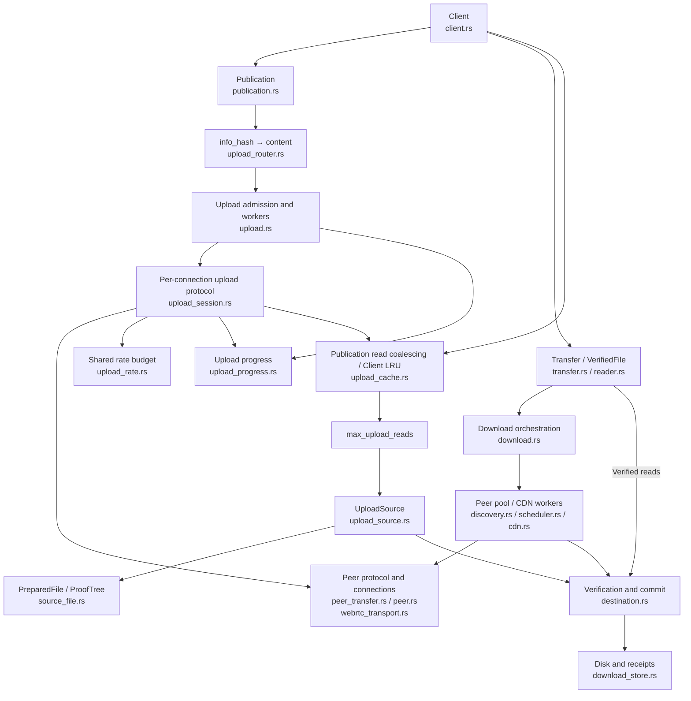

# Transport

This page describes the current Rust SDK data plane: authenticated peer connections, block transfer and delivery of verified bytes. See [Wire protocol](./wire) for message formats, [Scheduling](./scheduling) for work assignment and [CDN fallback](./cdn) for HTTP sources.

## SDK architecture

The diagram groups runtime responsibilities. Arrows represent calls or data interactions; the `download.rs` execution layer consists of functions and background tasks, rather than a separate service or public engine type.



The shared `control.rs` / `online.rs` modules sit outside this diagram and provide Track discovery, Punch sessions and heartbeat maintenance for publication and download tasks. The block queue and source policy are expanded in [Scheduling](./scheduling).

Track and Punch do not authenticate file bytes. Peer identity is confirmed through signatures on the connection, and content is verified against the Seed's Merkle root. Track discovers holders; Punch relays connection signals. File bytes arrive over peer data channels or HTTP.

## Establishing an authenticated connection

1. Query Track for complete and partial holders on the current page, deduplicate candidates and exclude the local peer. Complete holders are preferred; candidates refresh every five seconds.
2. Request connection consent through Punch, then exchange SDP and ICE candidates after acceptance.
3. `webrtc-rs/webrtc` establishes ICE / DTLS / SCTP connectivity and opens two DataChannels.
4. Exchange random challenges and Ed25519 signatures on the reliable control channel before starting the file protocol.

The signed transcript binds the initiator/responder roles, both public keys, `info_hash`, connection ID, both nonces and both DTLS certificate SHA-256 fingerprints. Expected keys come from the connection ticket or Track candidate and are checked against peer_id. Identity frames are limited to 512 bytes and the exchange to 10 seconds. Invalid stages, versions, signatures or fingerprints fail the connection.

## Two data channels

| Channel | Configuration | Purpose |
| --- | --- | --- |
| `q2q-control` | Reliable, ordered, created by the initiator through DCEP | Identity, bitfields, requests, proofs, acknowledgements and cancellation |
| `q2q-data` | Explicit negotiated stream 1 on both sides, unordered, `max_retransmits = 0` | Binary pieces |

Each channel has a 256 KiB send buffer limit with backpressure. Missing pieces are recovered through the file protocol's `piece_nack` messages.

The current dependency has limitations when restoring retransmission settings for remotely announced DCEP channels, so both peers configure the data channel explicitly. The control channel retains its DCEP handshake to ensure the remote endpoint is ready for the first identity frame. Applications do not manage these channels.

## Content verification boundary

Verification operates on blocks, 256 KiB by default. Each block is sent as 1024-byte pieces, with a shorter final piece where needed. A connection requests one block at a time.

After receiving the bytes and proof, Destination verifies length and the Merkle proof before writing. It serializes destination writes, rechecks disk bytes, syncs the data and syncs the receipt. Only then does it complete the block lease, grow progress and send `have` / `block_done`. See [Scheduling](./scheduling#from-fetch-to-completion) for the order.

VerifiedFile reads completed blocks and checks disk bytes against authenticated leaf hashes. The destination may already have its final allocated length; applications should use SDK reads rather than treating sparse zero bytes as downloaded content.

## Lifecycle and current scope

Publication manages announcements, holding renewal, uploads and withdrawal. Active publications and downloads share one heartbeat task per control session. The last user releasing its lease stops that task. Callers using the lower-level `Client::connect()` alone must still maintain heartbeats themselves.

Dropping a transfer or reader cancels network tasks. Blocking disk jobs already started can finish and retain the destination lock until they do. Block proofs are stored in `.q2q.resume`; resume reads and verifies the disk bytes again. A complete file can resume offline.

The SDK supports fixed files and VOD with a single read cursor. Each Client supports up to 32 distinct active content hashes, serving multiple downloading peers concurrently (`max_upload_peers` defaults to 4, range 1–16). Discovery refreshes the current Track page, without pagination. Files are limited to 65,536 blocks, or 16 GiB with the default block size. Partial-file sharing is opt-in. Live indexes and browser adaptation are not implemented yet.

## Concurrent uploads

`client::builder().max_upload_peers(4)` sets the per-Client upload connection budget, independently of `max_download_peers`. A slot is reserved before accepting a handshake and remains occupied during negotiation, transfer and idle VOD connections. Full capacity returns Busy through Punch; low-level dialing exposes `ControlError::Busy`. There is no server-side upload waiting queue. Download scheduling tries other candidates and retries known peers after five seconds; configured CDNs remain a fallback.

One reader owns the standing Punch channel. The Client upload router dispatches validated Connect tickets by info_hash into bounded content mailboxes; other signals are routed by `connection_id` into independent bounded mailboxes. Each upload task negotiates and transfers independently. Remote disconnects, timeouts and protocol failures end that task; source read failures or changed content stop the entire publication and withdraw its announcement.

Upload tasks share a read-only file handle, Seed and Merkle tree. Unix/Windows use absolute-offset reads without a shared cursor mutex around reads and verification; a separate budget bounds concurrent source reads. `Publication::close()` stops admission for that content and waits for upload tasks and in-flight blocking reads before withdrawing. Drop triggers the same asynchronous cleanup. Closing one content leaves other contents active. The last registration closes the shared admission gate and drains pending requests; duplicate active hashes are rejected.

Callers using `ControlSession::accept_peer` / `PeerSession::serve_file` manage their own tasks and concurrency budget. Connection capacity does not limit total upload bandwidth.

### Total upload rate

```rust
let client = q2q::client::builder()
    // ... Track, identity and storage settings ...
    .max_upload_peers(4)
    .upload_rate_limit(10 * 1024 * 1024) // bytes per second across this Client
    .build()
    .await?;
```

Omit `upload_rate_limit` for unlimited uploads; zero is invalid. Managed publications share a single Client-owned token bucket, including across publication lifetimes. Each encoded piece is charged before sending, including its 17-byte header, short final pieces and retransmits. Control messages and WebRTC/SCTP/DTLS/UDP overhead are excluded, so this is not a cap on total network interface traffic. Low-level `PeerSession::serve_file` remains caller-managed and unlimited.

The bucket allows a burst of 100 ms of configured traffic, with a minimum burst of one full piece (1041 bytes). Idle time cannot accumulate extra burst credit. Waiting holds neither the source lock nor a future bandwidth reservation; cancellation removes the wait immediately. When rate limiting is enabled, waiting connections take FIFO turns for one piece of budget. Each connection has at most one pending request and rejoins at the back after sending; retransmits use the same turns. Standard pieces have equal sizes, so continuously ready connections get approximately equal byte shares; short final pieces are still charged at their actual length. Idle VOD connections and connections waiting on network or disk I/O do not queue, allowing others to use spare bandwidth. This guarantees turns among ready requests, not equal observed network throughput. Weights and priorities are not implemented; unlimited uploads do not use this scheduling.

Upload tasks keep consuming both channel event queues, so buffer notifications cannot stall the RTC driver; received control messages use a bounded inbox. While waiting, the uploader sends `upload_wait` hints on the control channel. The receiver defers missing-piece retries and keeps its progress deadline alive. Actual DataChannel sends retain a 20-second timeout; time waiting for rate budget is excluded. VOD `read_timeout` still bounds application reads. Rate-limited uploads require receivers that understand this new control message; older receivers reject unknown message types. Unrestricted uploads do not emit the hints.

### Upload progress and subscriptions

```rust
let publication = client.publish_file("video.mp4").await?;
let snapshot = publication.progress();
let mut updates = publication.subscribe_progress();

// Usually consumed by a UI/monitor task; another task closes publication.
loop {
    let snapshot = updates.borrow_and_update().clone();
    // Update the UI. Never hold a watch borrow across an await.
    if matches!(snapshot.state,
        q2q::publication::PublicationState::Closed
        | q2q::publication::PublicationState::Failed) {
        break;
    }
    if updates.changed().await.is_err() { break; }
}
```

`UploadProgress` exposes cumulative `sent_bytes`, its `retransmitted_bytes` subset, handshake/active/idle connection counts and completed/failed/cancelled session counts. `connections` contains only live admitted connections, with connection ID, Peer ID, state and byte counters, bounded by upload capacity. Capacity rejections and requests failing before admission are excluded. Finished records are removed while totals remain. A new publication starts from zero; caller-managed low-level uploads are excluded.

Connection states are `Handshaking`, `Idle` and `Sending`. The Peer ID comes from a verified ticket during negotiation and is authenticated when the handshake completes. `Sending` includes source reads, rate-budget waits, network sends and waiting for BlockDone; active connections are not necessarily consuming network bandwidth. A valid BlockDone returns the connection to idle. A normal session end increments completed even if it served only part of the file. Remote disconnects, timeouts, protocol or source errors increment failed; local worker cancellation, including publication shutdown, increments cancelled. An isolated remote failure does not fail the publication.

Byte counters follow the rate-limit accounting: encoded piece bytes, including the 17-byte header, short final pieces and retransmits, counted only after DataChannel accepts the send. Failed sends add nothing. These counters do not represent receive acknowledgements, unique file bytes or durable bytes. Control messages and transport overhead are excluded. Applications derive speed from byte deltas and local elapsed time; the SDK stores no speed history.

`progress()` returns current counters immediately. Normal watch updates are coalesced every 100 ms; subscribing also synchronizes the latest value. Closing and terminal states notify immediately, and final counters can continue changing during cleanup. Publication transitions from `Publishing` through `Closing` to `Closed`, or enters `Failed` on error. Live records are empty after cleanup. Retain a receiver before close to read final snapshots after close consumes the handle; Drop triggers the same asynchronous cleanup. Watch updates can merge; unread notifications do not backpressure uploads. Clone borrowed watch values promptly and never retain the read guard across an await.

### Admission ownership and module boundaries

`admission.rs` owns admission leases for the shared control session. One Client upload router owns managed admission for all registered contents; multiple low-level `accept_peer` calls may coexist, but the two modes cannot overlap. Conflicts return `ControlError::AdmissionConflict`, and low-level accepts cannot reopen a managed publisher’s gate. Manual leases last through acceptance/negotiation or cancellation; managed leases remain until upload tasks, blocking reads and withdrawal finish. An independent pause notification wakes readers waiting for requests or the queue lock with `AdmissionPaused` before buffered requests are drained.

`upload_router.rs` owns the Client reader and dispatches by content hash. `upload_source.rs` defines the internal Seed/availability/read interface, implemented by prepared files and download destinations. `upload.rs` organizes capacity, handshake workers and error isolation. `upload_session.rs` owns per-connection resources, event consumption and upload protocol handling. Download protocol and shared control-message helpers remain in `peer_transfer.rs`. A private runner in `publication.rs` unifies startup, renewal, stop and withdrawal. Every exit refuses new requests for that content, waits for workers and blocking reads, withdraws, releases its registration and then publishes the terminal snapshot. The final registration releases managed admission. Source and test directories remain flat.

### Concurrent complete-source reads

```rust
let client = q2q::client::builder()
    // ... Track, identity and storage settings ...
    .max_upload_peers(8)
    .max_upload_reads(4) // default 4, range 1–16
    .build().await?;
```

Receivers can read different blocks concurrently, including arbitrary VOD seeks. Managed uploads merge simultaneous reads of the same block and retain verified data/proofs in the bounded cache below. Unix uses read_at and Windows uses seek_read with an absolute offset on every call. Windows may update the file cursor, but uploads never depend on that cursor. Other platforms retain a locked seek/read fallback.

`max_upload_reads` is independent of connection capacity and rate limits. Sources prepared by the same Client share the budget; PreparedFile clones share the original open file, metadata and proof tree. SDK uploads acquire capacity before spawn_blocking, so queued jobs remain cancelable. Started jobs retain capacity through reads, length/modification-time checks, leaf verification and proof generation. Network sends and acknowledgement waits hold no read slot. close/Drop still waits for in-flight reads to finish and release both read and connection capacity before shutdown completes.

On complete-source cache misses and in the synchronous API, every disk read checks the open file’s length and modification time before and after I/O and verifies the committed block leaf. Premature EOF caused by truncation is SourceChanged. Replacing the path does not replace the original open source. The synchronous `PreparedFile::read_verified_block(&self, index)` does not acquire the SDK async budget; callers creating their own threads manage concurrency themselves. The low-level serve_file parameter remains `Arc<Mutex<PreparedFile>>`; it briefly locks once to clone the immutable handle and performs no upload I/O under that lock.

This removes SDK cursor serialization, not physical disk or CPU contention. Throughput is not guaranteed to scale with receiver count.


## Sharing while downloading

Sharing is disabled by default. Ordinary downloads return an independent upload handle when explicitly requested:

```rust
let (transfer, sharing) = client.download_shared(&seed, "download.bin").await?;
let path = transfer.wait().await?;
// Keep sharing to continue seeding the completed file.
sharing.close().await?;
```

`resume_download_shared` revalidates receipts before sharing existing blocks. VOD uses `client.open(&seed, "video.mp4").share(true).await?`; the reader owns the upload handle by default. `file.sharing()` observes it; `file.take_sharing()` transfers ownership to the application. Closing sharing leaves download/read activity running. Cancelling or failing an incomplete download/reader stops sharing, even if the application retained the upload handle. A completed download continues seeding until that handle closes or drops. Upload failures are observable through its progress and close result and do not silently cancel the download.

The first verified block is announced only after both its data and proof receipt are durable and the upload route exists. Track receives add=[hash] with an empty complete set. Later committed blocks produce Have messages on existing connections, with coalesced availability notifications. No per-block Track request is made. Once every block is committed and final file sync succeeds, an announcement upgrades the holding to complete. Heartbeats and holding renewal continue while sharing is active; closing or a source failure withdraws that hash.

A download source uses an in-memory block-to-receipt-offset index, rebuilt only from revalidated receipts on resume. Upload reads seek directly to the bounded proof record and verify disk bytes and proof against the Seed root again. Uncommitted sparse bytes are unavailable. Destination reads and writes currently serialize under the destination lock; complete-source positional reads remain independent. Both source types share the Client's upload connection, blocking-read and rate budgets, plus the bounded upload cache below.

`PublicationState::Publishing` includes waiting for the first shareable block; `download_shared` returns before its first announcement. Use Track discovery when an external observer needs confirmation of visibility. A source or announcement failure produces Failed and is returned by close. Failed withdrawal can leave a stale Track entry until its holding TTL expires; the local upload route still closes.


## Bounded upload block cache

```rust
let client = q2q::client::builder()
    // ... Track, identity and storage settings ...
    .upload_cache_bytes(16 * 1024 * 1024) // default 16 MiB, maximum 256 MiB
    .build().await?;
```

All managed publications and download-sharing handles on one Client share this LRU budget. Entries are isolated by publication instance and block index; a later publication cannot reuse an earlier source's bytes. A retained entry accounts for data, proof vector capacities and basic entry/block structures. Hash-table allocation, in-flight reads, connection-owned send/retry blocks and DataChannel buffers are separate; this is not a process RSS cap. Active readers may keep an evicted Arc alive. No memory is reserved up front.

Zero disables retention while still merging simultaneous reads. A block larger than the budget is shared with current waiters but not retained. Only successful verified reads can populate entries. Concurrent requests for one block share one immutable data/proof allocation; different blocks retain independent reads. BlockDone releases the connection's reference, while the LRU may keep the block for another receiver. Network pacing and retransmission accounting are unchanged. Caller-managed low-level serve_file uploads remain uncached; synchronous PreparedFile reads also retain their original behavior.

Hits still run a bounded blocking availability/metadata check. Complete sources compare the original open file's length and modification time against preparation. Cache revisions also include Unix ctime; download sources include both data-file and proof-receipt-file metadata. A changed revision removes the requested old entry and causes a fresh verified read; older entries are invalidated lazily before use. Normal commits to a growing download may conservatively invalidate existing entries. Hits do not re-read or rehash immutable cached bytes. Platforms without Unix ctime cannot promise detection of changes that preserve the observed metadata; returned cached bytes/proofs remain the previously authenticated snapshot. The cache does not grant access to uncommitted blocks.

A pending cache waiter consumes no read permit. Reads and hit checks acquire max_upload_reads before spawn_blocking. Cancelling the initiating request before spawning removes its flight so another waiter can retry. Once started, the blocking closure owns the flight, read permit, originating upload permit and task guard; it can publish the result for remaining waiters even after that connection is cancelled. Errors are not retained; the reading caller retains its typed error, and waiters can retry or observe closure. Closing a publication wakes waiters, clears only its entries and prevents late jobs from repopulating the cache. close still waits for its blocking jobs to release their permits. A failed source cannot keep serving old hits.

`BuildError::InvalidUploadCacheBytes` is returned for a budget above 256 MiB; exhaustive matches must handle the new variant. Performance measurements and reproducible workloads are recorded in the repository's upload-block-cache todo; they measure verified source-read calls, not physical disk I/O or end-to-end network throughput.
