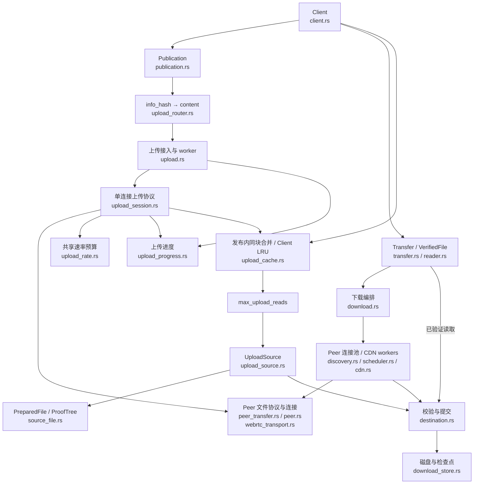

# 传输层

本文说明当前 Rust SDK 的数据面实现：建立已认证的 Peer 连接、传输文件块，并把通过校验的内容交给应用。消息格式见 [消息编码](./wire)，任务分配见 [调度](./scheduling)，HTTP 来源见 [CDN 回退](./cdn)。

## SDK 整体架构

下面按运行职责画图，连线表示调用或数据交互。`download.rs` 是执行层模块，内部通过函数和后台任务组织下载；图中节点不都对应独立的服务或公开类型。



共享的 `control.rs` / `online.rs` 位于图外，为发布和下载提供 Track 查询、Punch 会话与心跳维护。块队列与来源策略在 [调度](./scheduling) 中展开。

数据面不依赖 Track 或 Punch 为内容真实性背书：Peer 身份通过连接上的签名确认，内容通过 Seed 中的 Merkle 根验证。Track 做发现，Punch 转发连接信令；文件字节经 Peer 数据通道或 CDN 获取。

## 从发现到已认证连接

1. 客户端查询 Track，取得当前页的完整或部分持有者，去重并排除自身；优先完整持有者，每五秒刷新候选。
2. 下载方通过 Punch 请求连接，接收方同意后交换 SDP 与 ICE candidate。
3. `webrtc-rs/webrtc` 建立 ICE / DTLS / SCTP 连接，并打开两条 DataChannel。
4. 双方在可靠控制通道交换随机挑战及 Ed25519 签名，验证完成后才进入文件协议。

签名绑定发起方/接收方角色、双方公钥、`info_hash`、连接 ID、双方随机挑战和双方 DTLS 证书的 SHA-256 指纹。期望公钥来自连接票据或 Track 候选并按 peer_id 验证。身份消息每条最多 512 字节，整个确认阶段限时 10 秒；错误阶段、版本、签名或指纹均导致连接失败。

## 两条数据通道

| 通道 | 配置 | 用途 |
| --- | --- | --- |
| `q2q-control` | 可靠、有序，由发起方通过 DCEP 创建 | 身份确认、bitfield、请求、证明、确认和取消 |
| `q2q-data` | 双方显式配置 negotiated stream 1，无序、`max_retransmits = 0` | 二进制 piece |

发送缓冲上限为每条通道 256 KiB，超过时由底层施加背压。piece 丢失由文件协议中的 `piece_nack` 补齐。

当前依赖版本对远端 DCEP 通道的重传参数恢复存在限制，因此数据通道由双方显式配置；控制通道保留 DCEP 握手，确保远端就绪后再发送身份消息。这是 SDK 的传输适配细节，不要求应用管理通道。

## 文件块的信任边界

文件按 block 校验，默认 block 为 256 KiB；每个 block 按 1024 字节 piece 传输，末尾可更短。一个连接同时只请求一个 block。

收到整块字节及证明后，`Destination` 先验证长度和 Merkle 证明，再串行写入目标、从磁盘复核、同步数据并同步检查点。完成后才增长进度、释放块租约并发送 `have` / `block_done`。详细顺序见 [调度](./scheduling#从取块到完成)。

`VerifiedFile` 只读取已完成的块，读取时还会核对磁盘字节与已认证叶子哈希。目标文件可能已预分配长度，应用应使用 SDK 读取接口，不能把稀疏文件中的零字节当成已下载内容。

## 生命周期与当前范围

`Publication` 负责宣告、文件持有续租、上传和撤销；活跃发布及下载共用控制会话的一个心跳任务。最后一个使用者释放后，心跳任务停止；低层 `Client::connect()` 的调用者仍需自行维护心跳。

Drop 下载或读取句柄会取消网络任务。已经开始的阻塞磁盘操作可以完成，目标锁在操作结束前继续持有。每块证明保存在 `.q2q.resume`，恢复时重新读取并验证磁盘内容，完整文件可离线恢复。

当前支持固定文件的下载和单游标 VOD。每个 Client 可同时注册最多 32 个不同内容哈希，每个发布句柄可同时服务多个下载 Peer（`max_upload_peers` 默认 4，范围 1–16）；候选来自当前 Track 页，每五秒刷新，暂不分页。最多 65,536 个 block，默认块大小对应 16 GiB。部分文件共享由应用显式开启；直播索引和浏览器适配尚未实现。

## 并发上传

`client::builder().max_upload_peers(4)` 设置每个 Client 的上传连接额度，独立于 `max_download_peers`。握手前预留额度，握手、传输和 VOD 空闲连接均占用一个名额；连接结束后释放。容量满时通过 Punch 返回 Busy，低层建连接口返回 `ControlError::Busy`。不提供服务端上传等待队列；下载调度尝试其他候选，并在五秒退避后重试已知 Peer，配置的 CDN 仍可兜底。

Punch 常驻信道只有一个读取者。Client 上传路由器将通过票据校验的 Connect 按 info_hash 分发到有界内容邮箱，其余信令按 `connection_id` 分发到独立有界邮箱；每个上传任务自行完成握手与传输。远端断开、超时或协议错误只结束对应任务；源文件读取失败或内容变化会终止整个发布并撤销宣告。

所有上传任务共享只读源文件句柄、Seed 与 Merkle 树。Unix/Windows 按绝对偏移读取，不用共享游标锁串行化读取和校验；源读取并发由独立额度限制。`Publication::close()` 停止接入并等待全部上传任务和在途阻塞读取，再撤销宣告；Drop 触发相同的异步清理。发布关闭期间的新请求被拒绝，待接入队列不会留给下一次发布。

低层 `ControlSession::accept_peer` / `PeerSession::serve_file` 调用者自行管理上传任务和并发额度。连接额度不是总上传速率限制。

### 总上传速率

```rust
let client = q2q::client::builder()
    // ... Track、身份文件和存储目录配置 ...
    .max_upload_peers(4)
    .upload_rate_limit(10 * 1024 * 1024) // 此 Client 总计的字节/秒
    .build()
    .await?;
```

不设置 `upload_rate_limit` 表示不限速，0 为无效配置。所有托管上传共用 Client 持有的一个令牌桶，重新发布也复用同一预算。每个 piece 发送前按编码后的实际长度扣费，包含 17 字节头、末尾短片和重传；控制消息及 WebRTC/SCTP/DTLS/UDP 开销不计入，因此它不是网卡流量总上限。低层 `PeerSession::serve_file` 仍由调用者管理，默认不限速。

突发额度为配置速率的 100 毫秒，至少允许一个完整 piece（1041 字节）；空闲不能积累更多突发额度。等待预算时不持有源文件锁，也不预占未来额度，取消可以立即结束等待。启用限速时，等待预算的连接按 FIFO 轮流领取一个 piece 的额度。每个连接最多有一个待领取请求，发送后再次排到队尾；重传同样参与轮转。标准 piece 等长，因此持续就绪的连接获得近似相等的字节份额，末尾短片仍按实际长度计费。空闲 VOD 或正在等待网络/磁盘的连接不排队，其他连接可使用空出的带宽。这里保证就绪请求的轮次，不保证实际网络吞吐相等，也不提供连接权重或优先级；不限速模式不启用此调度。

上传期间持续消费控制与数据通道事件，避免缓冲通知阻塞 RTC 驱动；接收的控制消息队列有界。上传端等待预算时通过控制通道发送 `upload_wait` 提示，接收端暂缓缺片重试并延长进展截止时间。实际 DataChannel 发送仍有 20 秒超时，限速等待不计入；VOD 的 `read_timeout` 继续限制应用读取。限速上传要求接收端支持这个新增控制消息，旧接收端会拒绝未知消息类型；不限速上传不发送该提示。

### 上传进度与订阅

```rust
let publication = client.publish_file("video.mp4").await?;
let snapshot = publication.progress();
let mut updates = publication.subscribe_progress();

// 通常在独立 UI/监控任务中读取；另一个任务负责关闭发布。
loop {
    let snapshot = updates.borrow_and_update().clone();
    // 使用 snapshot 更新 UI；不要跨 await 持有 watch 借用。
    if matches!(snapshot.state,
        q2q::publication::PublicationState::Closed
        | q2q::publication::PublicationState::Failed) {
        break;
    }
    if updates.changed().await.is_err() { break; }
}
```

`UploadProgress` 提供累计 `sent_bytes`、其中的 `retransmitted_bytes`，以及握手、活跃、空闲连接数和完成、失败、取消连接数。`connections` 只保留当前已获上传额度的连接，包含 connection ID、Peer ID、状态及发送/重传字节；记录数不超过上传连接额度。容量拒绝和校验前失败不计入已接入连接的统计；结束后删除明细，保留累计汇总。重新发布从零开始，低层自行管理的上传不计入。

连接状态为 `Handshaking`、`Idle`、`Sending`。Peer ID 在握手期间来自已验证的票据，握手后完成对端认证；`Sending` 覆盖读取源文件、等待速率预算、发送及等待 BlockDone，因此活跃连接数不等于正在占用网络的连接数。收到有效 BlockDone 后变为空闲。正常结束本次文件会话增加完成数，即使它只补了部分块；远端断开、超时、协议或源错误增加失败数；本地关闭或取消 worker 增加取消数。远端单连接失败不会把整个发布标成失败。

发送字节的口径与限速一致：编码后的 piece（含 17 字节头、末尾短片和重传），只在 DataChannel 接受发送后计入；失败的发送不增加计数。它不是接收确认、唯一文件字节或已持久化字节，控制消息和传输层开销不在其中。`retransmitted_bytes` 是 `sent_bytes` 的子集。速度由应用按本地时间和计数增量计算，SDK 不保存速率历史。

`progress()` 直接取得最新计数；普通订阅通知每 100 毫秒合并一次，新建订阅时也会同步最新值。关闭中及终态立即通知，清理期间最终计数可能继续变化。发布状态为 `Publishing → Closing → Closed`，出错则进入 `Failed`；最终清理后连接明细为空。调用 close 前保留订阅，可在 close 消费句柄后继续读取最终快照；Drop 同样触发异步清理。watch 通知允许合并，未消费通知不会阻塞上传；请及时克隆借用值，避免跨 await 持有 watch 借用锁。

### 接入所有权与模块边界

`admission.rs` 为共享控制会话管理接入租约：一个 Client 上传路由器为所有注册内容持有托管接入租约，多个低层 `accept_peer` 可共存，但两种模式不能同时运行。冲突返回 `ControlError::AdmissionConflict`，低层调用不会重新打开托管发布的接入开关；低层租约在接入/握手完成或取消时释放，托管租约在上传任务、阻塞读取和撤销宣告完成后释放。暂停通过独立通知唤醒正在等待请求或队列锁的读取者，返回 `AdmissionPaused`，然后清空待接入请求。

`upload_router.rs` 持有 Client 读取者，按内容哈希分发。`upload_source.rs` 提供内部 Seed、可用块与读取接口，完整源和下载目标分别实现。`upload.rs` 只组织额度、握手 worker 和错误隔离；`upload_session.rs` 拥有单连接上下文、事件消费与文件上传协议。下载协议和共用控制消息辅助函数保留在 `peer_transfer.rs`。`publication.rs` 的私有运行器统一处理初始化、续租、停止及撤销，所有退出路径都先拒绝该内容的新请求、等待任务与阻塞读取，再撤销宣告并释放注册、发布终态。关闭一个内容不影响其他内容，最后一个注册退出后才关闭共享接入并释放托管租约。源码和测试均保持扁平目录。

### 完整源的并发读取

```rust
let client = q2q::client::builder()
    // ... Track、身份和存储配置 ...
    .max_upload_peers(8)
    .max_upload_reads(4) // 默认 4，范围 1–16
    .build().await?;
```

多个下载方可以同时读取不同块，包括 VOD 的任意位置跳转；托管上传合并同块在途读取，并按下述预算保留已验证数据和证明。Unix 使用 read_at，Windows 使用 seek_read，每次读取都带绝对偏移，不依赖其他请求留下的游标位置。Windows API 可能更新文件游标，但上传路径不使用该游标；其他平台保留加锁 seek/read 的兼容回退。

`max_upload_reads` 与连接数、速率限制分别配置。同一个 Client 准备的源文件共用读取额度，克隆 PreparedFile 也共享原文件、元数据和证明树。SDK 在 spawn_blocking 前等待额度，排队任务可以取消；开始的阻塞任务在读取、长度/修改时间检查、叶子校验和证明生成结束后才释放额度。网络发送与等待下载方确认不占读取名额。close/Drop 继续等待在途读取真正结束，归还读取和连接额度后才完成关闭。

完整源缓存未命中及同步 API 的磁盘读取，仍在读取前后检查已打开文件的长度/修改时间，并校验该块的已认证叶子；缩短文件造成的提前 EOF 也作为 SourceChanged。路径被替换时继续使用原已打开文件，不重新按路径打开另一份内容。同步 `PreparedFile::read_verified_block(&self, index)` 本身不等待 SDK 的异步额度，自行创建线程的调用者需要管理并发。低层 serve_file 的 `Arc<Mutex<PreparedFile>>` 参数保持不变，仅在开始时短暂获取锁来克隆只读句柄，之后上传不持有该锁。

这个改造消除了 SDK 的共享游标排队，不保证物理磁盘吞吐随连接数增长；磁盘、CPU 和系统文件缓存仍由各请求共享。


## 边下载边共享

默认不开启共享。普通下载显式返回独立上传句柄：

```rust
let (transfer, sharing) = client.download_shared(&seed, "download.bin").await?;
let path = transfer.wait().await?;
// 保留 sharing，完整文件下载完成后仍继续做种。
sharing.close().await?;
```

`resume_download_shared` 先重新校验恢复记录，再共享已有块。VOD 使用 `client.open(&seed, "video.mp4").share(true).await?`，默认由 reader 持有上传句柄；`file.sharing()` 可观察上传，`file.take_sharing()` 可将句柄交给应用独立持有。关闭共享不取消下载或读取；取消或失败的未完成下载/reader 会终止共享，即使应用已取走上传句柄。完整下载在上传句柄关闭或 Drop 前继续做种。上传错误通过上传进度及 close 结果报告，不隐式取消下载。

首个块完成根校验、数据与证明记录持久化，且上传路由就绪后，才向 Track 发送 add=[hash]、complete=[]。后续已提交块通过现有连接发送 Have，可用性通知可以合并，不为每个块请求 Track。所有块完成并最终同步成功后，再宣告为 complete。共享期间持续心跳与持有续期；关闭或来源错误撤销该内容哈希。

下载源维护块到证明记录偏移的内存索引，恢复时仅从重新校验通过的记录重建。上传直接定位有界记录，读取数据后再次按 Seed 根校验字节与证明，不暴露稀疏空洞或未提交块。下载目标目前仍在同一目标锁下串行读写；完整源保留并发按偏移读取。两类来源共用 Client 的上传连接、阻塞读取、速率额度，以及下述有界上传缓存。

`PublicationState::Publishing` 包括等待首个可共享块，`download_shared` 返回时不保证已经宣告。外部观察者需要确认可发现性时可查询 Track。来源或宣告失败进入 Failed，并由 close 返回原始错误；撤销失败时 Track 可能保留旧记录直到持有 TTL 到期，本地上传路由仍会关闭。


## 有界上传块缓存

```rust
let client = q2q::client::builder()
    // ... Track、身份和存储配置 ...
    .upload_cache_bytes(16 * 1024 * 1024) // 默认 16 MiB，最多 256 MiB
    .build().await?;
```

同一 Client 的所有托管发布和下载共享句柄共用 LRU 预算；条目按发布实例和块编号隔离，重新发布不复用旧来源的数据。计费包括数据、证明数组容量及条目/块的基本结构；哈希表分配、在途读取、连接持有的发送/重传块以及 DataChannel 缓冲另计，不等同进程 RSS 上限。正在发送的连接可以继续持有已淘汰条目的 Arc，预算不会预先分配整块内存。

设为 0 禁用保留，仍合并同时发生的同块读取；超过预算的单块只交给当前等待者、不保留。只有成功验证的读取可以填入缓存，同块请求共享一份不可变数据和证明，不同块仍可独立读取。BlockDone 释放连接引用，LRU 可以继续保留以服务其他下载方。限速和重传计数不变；调用者自行管理的低层 serve_file 上传不启用该缓存，同步 PreparedFile 读取也保留原行为。

命中仍执行有并发上限的阻塞状态/元数据检查。完整源对照准备时的原已打开文件长度与修改时间，缓存修订额外包含 Unix ctime；下载源还包含数据文件和证明记录文件的元数据。修订变化会移除本次请求的旧项并重新读取验证，其他旧项在使用前惰性失效。下载新增块也可能保守地使已有缓存失效。命中不重新读取或计算缓存字节的哈希；不支持 Unix ctime 的平台无法承诺发现保留所观察元数据的外部修改，但返回的仍是此前已认证的内容快照。缓存不会使未提交块变为可上传。

同块等待者不占读取额度；实际读取及命中检查在 spawn_blocking 前等待 max_upload_reads。发起请求在启动前取消，会移除合并记录，让其他等待者重试；启动后由阻塞闭包持有合并记录、读取额度、发起连接额度和任务计数，原连接取消后仍可向其他等待者交付结果。错误不缓存，实际读取者保留原始类型错误，等待者可能重试或观察到关闭。关闭发布会唤醒等待者、清除其条目并禁止晚完成的任务回填；close 继续等待阻塞任务真正归还额度。来源失败后不会靠旧命中继续提供服务。

预算超过 256 MiB 返回新增的 `BuildError::InvalidUploadCacheBytes`，穷举匹配需增加分支。性能数据和可重复工作负载记录在仓库 upload-block-cache todo 中；计数表示逻辑已验证块读取调用，不是物理磁盘 I/O，也不是端到端网络吞吐。
